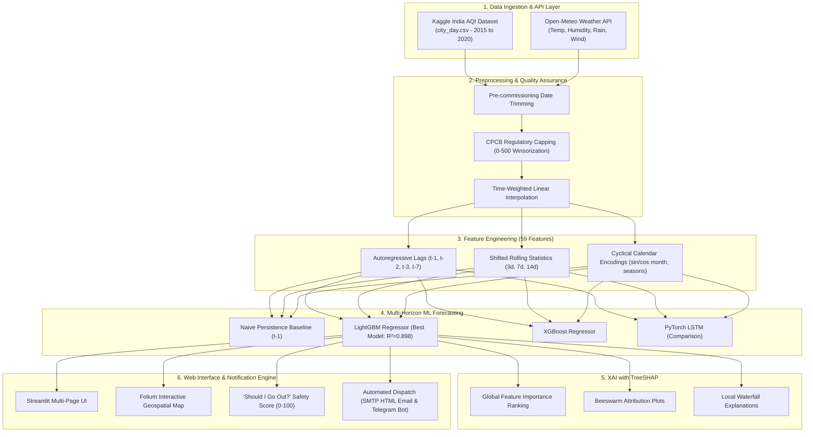

# 🌬️ AirSense: Air Quality Forecasting & Health Alert Platform

[](https://python.org)
[](https://streamlit.io)
[](https://github.com)
[](https://shap.readthedocs.io)
[](https://sdgs.un.org/goals/goal3)
[](https://sdgs.un.org/goals/goal11)
[](LICENSE)

> **College Final Year / 3rd-Year CSE Project**  
> An end-to-end Machine Learning and Full-Stack Geospatial Web Platform providing 24 to 72-hour air quality forecasts, game-theoretic SHAP explainability, demographic-tailored health advisories, and automated multi-channel early warning alerts for 8 major Indian metropolitan hubs:  
> **Delhi, Mumbai, Kolkata, Chennai, Bengaluru, Hyderabad, Ahmedabad, and Jaipur.**

---

## 📌 Table of Contents
- [Live Demo & Video](#-live-demo--video)
- [System Architecture](#-system-architecture)
- [Key Features](#-key-features)
- [Machine Learning Benchmark](#-machine-learning-benchmark)
- [Model Explainability with SHAP](#-model-explainability-with-shap)
- [CPCB Regulatory Standards & Health Advisories](#-cpcb-regulatory-standards--health-advisories)
- [Project Structure](#-project-structure)
- [Quickstart: Local Installation](#-quickstart-local-installation)
- [Deployment & Automation](#-deployment--automation)
- [UN Sustainable Development Goals (SDGs)](#-un-sustainable-development-goals-sdgs)
- [Viva & Technical Defense Highlights](#-viva--technical-defense-highlights)

---

## 🚀 Live Demo & Video

- **🌐 Live Web App:** [https://airsense-india.streamlit.app](https://share.streamlit.io) *(Deployable on Streamlit Community Cloud)*
- **🎥 2-Minute Demo Video:** [Watch Project Walkthrough on YouTube](https://youtube.com) *(Insert your recording link here)*

---

## 🏗️ System Architecture



---

## ✨ Key Features

1. **Multi-Horizon ML Forecasting (24h, 48h, 72h):**
   - Predicts multi-step future AQI with 95% confidence intervals using gradient boosted decision trees.
2. **Interactive National Geospatial Map:**
   - Color-coded Folium markers across 8 major Indian cities with CPCB category classification and pollutant popups.
3. **Multi-City Comparison Hub:**
   - Compare multi-year historical trajectories, monthly seasonality patterns, and pollutant distributions side-by-side.
4. **"Should I Go Out?" Outdoor Safety Score (0–100):**
   - Personalizes risk assessments across four vulnerability profiles (*General Public, Asthma Patients, Elderly/Children, Outdoor Workers*).
5. **Game-Theoretic Explainability (SHAP):**
   - Demystifies black-box predictions by visualizing exact Shapley value contributions for each atmospheric variable.
6. **Multi-Channel Alert Dispatch:**
   - Transmits urgent warnings via responsive HTML email and Telegram when forecasted AQI crosses user-defined hazard thresholds.
7. **Production MLOps & GitHub Actions:**
   - Daily scheduled cron workflow (`0 0 * * *`) that refreshes weather data, retrains models, evaluates performance, and auto-deploys updates.

---

## 🏆 Machine Learning Benchmark

All models were evaluated on the **holdout test set (Jan 2020 to Jun 2020, 1,456 samples)** using a strict chronological split to prevent temporal data leakage:

| Model Architecture | MAE (AQI pts) | RMSE | $R^2$ Score | MAPE (%) | MAE Improvement | RMSE Improvement |
| :--- | :---: | :---: | :---: | :---: | :---: | :---: |
| 🥇 **LightGBM Regressor** | **15.66** | **27.00** | **0.8977** | **13.25%** | **+14.98%** | **+20.56%** |
| 🥈 **XGBoost Regressor** | 15.70 | 26.90 | 0.8984 | 13.28% | +14.77% | +20.86% |
| 🥉 **Naive Persistence ($t-1$)** | 18.42 | 33.99 | 0.8378 | 13.97% | Baseline (0.0%) | Baseline (0.0%) |
| 🔬 **PyTorch LSTM (Sequence)** | 19.87 | 31.68 | 0.8591 | 17.13% | -7.87% | +6.80% |

---

## 🔍 Model Explainability with SHAP

TreeSHAP reveals the atmospheric factors influencing forecasts:

- **Primary Inertia:** `AQI` and `PM2.5` from previous days carry the highest predictive weight.
- **Atmospheric Dispersion:** `wind_speed_max` and `precipitation` exhibit strong **negative SHAP values** (high wind and rain wash out particulates, reducing predicted AQI).
- **Combustion Proxies:** `CO` and `NOx` act as leading vehicular and industrial combustion indicators.

---

## 🩺 CPCB Regulatory Standards & Health Advisories

AirSense adheres to the **Central Pollution Control Board (CPCB) NAQI** standards:

| Category | AQI Range | Color Code | General Public Advice | Asthma / Vulnerable Groups |
| :--- | :---: | :---: | :--- | :--- |
| **Good** | 0 – 50 | `#00B050` | Clean air; ideal for all outdoor activities. | No restrictions. |
| **Satisfactory** | 51 – 100 | `#92D050` | Minor irritation in rare sensitive groups. | Normal outdoor activity; stay hydrated. |
| **Moderate** | 101 – 200 | `#FFC000` | Breathing discomfort in heavy traffic. | Reduce intense cardio; wear mask in traffic. |
| **Poor** | 201 – 300 | `#FF6600` | Unhealthy air; throat & eye irritation. | Avoid outdoor workouts; N95 mask required. |
| **Very Poor** | 301 – 400 | `#FF0000` | Respiratory distress on prolonged exposure. | Stay strictly indoors; keep inhalers ready. |
| **Severe** | 401 – 500+ | `#990033` | Emergency hazard; affects healthy people. | Sealed indoor rooms; N99/P100 respirator. |

---

## 📁 Project Structure

```
airsense/
├── .github/workflows/
│   └── retrain_and_refresh.yml   # Daily GitHub Actions automated retraining
├── .streamlit/
│   └── config.toml               # Streamlit Cloud custom emerald UI theme
├── app/
│   ├── app.py                    # Multi-page Streamlit web app
│   └── utils.py                  # Inference, forecasting, and geospatial helpers
├── data/
│   ├── raw/                      # Kaggle city_day.csv (excluded from git)
│   └── processed/                # Cleaned datasets and Open-Meteo weather cache
├── models/                       # Serialized LightGBM, XGBoost, and SHAP artifacts
├── notebooks/
│   ├── 01_eda_and_cleaning.ipynb # Comprehensive Jupyter EDA notebook
│   ├── generate_eda_plots.py     # Static high-res chart generator
│   └── plots/                    # Exported EDA visualizations
├── reports/figures/              # Exported SHAP beeswarm and bar charts
├── src/
│   ├── __init__.py
│   ├── data_loader.py            # Data loading, validation, and city filters
│   ├── preprocessing.py          # Outlier capping & time-series interpolation
│   ├── features.py               # Lags, rolling windows, and Open-Meteo API
│   ├── train.py                  # Chronological training & benchmark pipeline
│   ├── evaluate.py               # Performance metrics (MAE, RMSE, R²)
│   ├── explain.py                # TreeSHAP explainability routines
│   ├── advisory.py               # CPCB categories & health risk scoring
│   └── alerts.py                 # Multi-channel SMTP and Telegram notifications
├── .env.example                  # Environment secrets template
├── .gitignore                    # Git tracking rules
├── requirements.txt              # Production dependency specifications
└── README.md                     # Comprehensive project documentation
```

---

## 💻 Quickstart: Local Installation

### 1. Clone & Set Up Environment
```bash
git clone https://github.com/<your-username>/airsense.git
cd airsense
python -m venv venv

# Activate Virtualenv (Windows)
venv\Scripts\activate

# Install Dependencies
pip install -r requirements.txt
```

### 2. Configure Environment Variables
```bash
cp .env.example .env
# Edit .env with your optional Telegram / Gmail App Password credentials
```

### 3. Run Pipeline Steps
```bash
# Test data loading
python -m src.data_loader

# Run cleaning & interpolation
python -m src.preprocessing

# Generate features & fetch Open-Meteo weather
python -m src.features

# Train and benchmark models
python -m src.train

# Compute SHAP explanations
python -m src.explain

# Launch the Streamlit Web Application
streamlit run app/app.py
```

---

## 🌐 Deployment & Automation

### Streamlit Community Cloud
1. Push this repository to GitHub.
2. Visit [share.streamlit.io](https://share.streamlit.io) and create a **New app**.
3. Select repository and set Main file path to: `app/app.py`.
4. Configure optional notification tokens under **Settings $\rightarrow$ Secrets**.

### GitHub Actions Automation
- The `.github/workflows/retrain_and_refresh.yml` workflow automatically runs every day at 00:00 UTC (05:30 IST) to fetch latest weather, retrain models, update forecasts, and push refreshed artifacts back to GitHub.

---

## 🌍 UN Sustainable Development Goals (SDGs)

- **Target 3.9 (Good Health & Well-Being):** Substantially reduce the number of deaths and illnesses from hazardous air pollution through predictive, demographic-tailored advisories.
- **Target 11.6 (Sustainable Cities & Communities):** Reduce the adverse per capita environmental impact of cities by improving municipal air quality tracking and public awareness.

---

## 🎓 Viva & Technical Defense Highlights

1. **Why use a chronological split instead of K-Fold cross validation?**  
   *Air pollution is an autoregressive time-series process. Shuffling records leaks future values into the past, artificially inflating $R^2$ while failing completely when deployed on real future data.*
2. **Why cap AQI at 500 instead of standard 3-sigma outlier deletion?**  
   *Deleting rows introduces gaps in daily time sequences, breaking lag features ($t-1, t-7$). Capping at 500 aligns with regulatory CPCB definitions, preserves sequence continuity, and prevents gradient explosion in tree splits.*
3. **Why did LightGBM outperform LSTM in this setup?**  
   *For tabular daily aggregate time-series enriched with explicit lags, moving averages, cyclical month encodings, and weather features, gradient boosted decision trees construct sharp decision boundaries more effectively with lower data requirements than recurrent neural networks.*

---

## 📄 License
This project is licensed under the [MIT License](LICENSE).
