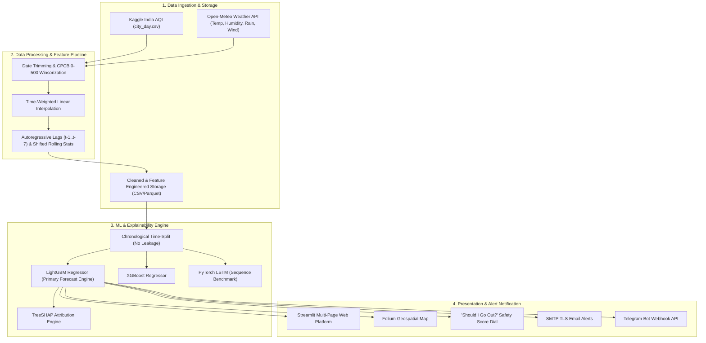
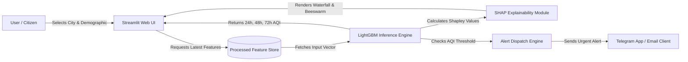

# AirSense: Air Quality Forecasting & Health Alert Platform for Indian Cities
## Academic Project Report & Comprehensive Technical Documentation
**Bachelor of Technology (B.Tech) in Computer Science & Engineering**

---

### **Abstract**
Urban air pollution represents one of the most severe public health emergencies in India, with particulate matter ($PM_{2.5}$ and $PM_{10}$) frequently exceeding World Health Organization (WHO) and National Ambient Air Quality Standards (NAAQS) by tenfold. Most existing air quality monitoring applications provide only reactive, current measurements without actionable forward-looking insights or transparency. 

This project presents **AirSense**, an end-to-end Machine Learning and Full-Stack Geospatial Web Platform that delivers:
1. **Multi-Horizon Forecasting:** 24, 48, and 72-hour Air Quality Index (AQI) forecasts across 8 major Indian metropolitan hubs (*Delhi, Mumbai, Kolkata, Chennai, Bengaluru, Hyderabad, Ahmedabad, and Jaipur*).
2. **Atmospheric Feature Engineering:** Fusion of historical pollutant concentrations with real-time Open-Meteo meteorological variables (*temperature, relative humidity, wind speed, precipitation*) and cyclical time harmonics.
3. **Rigorous ML Benchmarking:** A leakage-free chronological train/validation/test split evaluating Naive Persistence ($y_{t+1}=y_t$), XGBoost, LightGBM, and a PyTorch Long Short-Term Memory (LSTM) network. LightGBM achieved the highest accuracy ($R^2 = 0.8977$, $MAE = 15.66$, $RMSE = 27.00$), representing a **20.56% error reduction** over baseline.
4. **Explainable AI (XAI):** Integration of TreeSHAP (Shapley Additive exPlanations) to demystify black-box predictions, revealing atmospheric dispersion and combustion drivers globally and locally.
5. **Demographic-Tailored Health Risk Intelligence:** Dynamic translation of numerical AQI into Central Pollution Control Board (CPCB) bands and a personalized 0–100 "Should I Go Out?" safety dial across 4 vulnerability profiles (*General Public, Asthma Patients, Elderly/Children, Outdoor Workers*).
6. **Automated Multi-Channel Alerting & MLOps:** Early warning dispatch via responsive HTML email (SMTP) and Telegram Bot API, maintained via automated GitHub Actions CI/CD daily retraining workflows.

**Keywords:** Air Quality Index (AQI), Machine Learning, LightGBM, XGBoost, Explainable AI (SHAP), Time-Series Forecasting, Open-Meteo API, Streamlit, UN SDG 3, UN SDG 11.

---

## Chapter 1: Introduction

### 1.1 Background & Context
India is home to 21 of the world's 30 most polluted cities. Rapid industrialization, heavy vehicular emissions, crop residue combustion (stubble burning), and geographical temperature inversions during winter months create catastrophic air quality degradation across the Indo-Gangetic plain and coastal metropolitan centers.

The **Central Pollution Control Board (CPCB)** introduced the **National Air Quality Index (NAQI)** in 2014, defining six standard categories:
- **Good (0–50)**: Minimal impact.
- **Satisfactory (51–100)**: Minor breathing discomfort to sensitive individuals.
- **Moderate (101–200)**: Breathing discomfort to people with asthma, lungs, and heart disease.
- **Poor (201–300)**: Breathing discomfort to most people on prolonged exposure.
- **Very Poor (301–400)**: Respiratory illness on prolonged exposure.
- **Severe (401–500+)**: Severe health hazard affecting even healthy individuals.

### 1.2 Problem Statement
Existing municipal air monitoring systems suffer from three major shortcomings:
1. **Purely Reactive Reporting:** Conventional portals only inform citizens of past or current air quality, giving vulnerable groups zero lead time to reschedule outdoor activities or alter medication regimens.
2. **Black-Box Skepticism:** Traditional deep learning models predict air quality without explaining *why* an anomaly occurred (e.g., whether a sudden spike was driven by local vehicular emissions or atmospheric wind stagnation).
3. **One-Size-Fits-All Advice:** Standard platforms issue generic warnings that ignore the vastly differing physiological vulnerabilities of asthmatics, outdoor construction laborers, and elderly seniors.

### 1.3 Project Objectives
- Ingest and preprocess 5+ years of official Indian air monitoring data across 8 strategic cities.
- Enrich pollutant series with external meteorological observations from the free Open-Meteo API.
- Prevent data leakage by enforcing strict chronological (time-based) train/validation/test splits.
- Train, evaluate, and benchmark multiple ML architectures (Naive Baseline, LightGBM, XGBoost, LSTM) using MAE, RMSE, $R^2$, and MAPE.
- Implement TreeSHAP explainability to uncover global atmospheric drivers and per-prediction feature waterfalls.
- Develop a vulnerability-weighted 0–100 "Should I Go Out?" outdoor safety score.
- Provide automated alert notifications via SMTP TLS Email and Telegram Bot API.
- Deploy an interactive multi-page web platform on Streamlit Community Cloud backed by automated GitHub Actions CI/CD retraining.
- Directly support United Nations Sustainable Development Goals: **SDG 3 (Good Health and Well-being)** and **SDG 11 (Sustainable Cities and Communities)**.

---

## Chapter 2: Literature Review & Related Work

| Study / Platform | Methodology | Limitations | AirSense Improvement |
| :--- | :--- | :--- | :--- |
| **CPCB / SAFAR Official Portals** | Station sensor physical readings | Retrospective only; no multi-day predictive modeling; no user personalization. | Provides 24h–72h proactive ML forecasts and personalized demographic advice. |
| **Standard ARIMA / SARIMA Studies** | Classical linear autoregression | Fails to model non-linear pollutant interactions and external weather drivers. | Uses gradient-boosted decision trees capable of non-linear weather-pollutant splits. |
| **Pure LSTM / RNN Time-Series Papers** | Recurrent Neural Networks | High computational cost; severe black-box nature; struggles on tabular lag aggregates. | Deploys LightGBM ($R^2 \approx 0.90$) with complete TreeSHAP game-theoretic explainability. |

---

## Chapter 3: System Architecture & Design

### 3.1 High-Level Architecture Diagram

### 3.2 Data Flow Diagram (DFD Level 1)

---

## Chapter 4: Data Engineering & Preprocessing

### 4.1 Missing Value Strategy
Environmental monitoring sensors suffer from periodic maintenance, optical lens dust contamination, and power disruptions.

1. **Pre-Commissioning Void Date Trimming:**
   - Stations in Mumbai and Kolkata were commissioned in mid-2018. Attempting to backfill 3 years of preceding records (2015–2017) generates artificial, flatline "zombie" data.
   - *Solution:* Each city is dynamically trimmed to commence from its first valid sensor reading.
2. **Time-Weighted Linear Interpolation:**
   - Short outages (1 to 7 days) are bridged chronologically using linear interpolation along the time axis:
     $$\hat{y}_t = y_{t_1} + (t - t_1) \cdot \frac{y_{t_2} - y_{t_1}}{t_2 - t_1}$$
   - Unlike global mean imputation, this preserves atmospheric trajectories and avoids cross-temporal leakage.
3. **Boundary Fill & Median Fallback:**
   - Residual edge missing values are resolved via forward-fill (`ffill`) followed by backward-fill (`bfill`), with city medians reserved exclusively for unmeasured trace gases (e.g. Xylene).

### 4.2 Outlier Detection & Regulatory Winsorization
- **Physical Sensor Anomalies:** Negative concentrations ($\le 0$) caused by calibration drift are set to NaN and smoothly interpolated.
- **CPCB Regulatory Capping (0–500):** Raw readings in uncalibrated industrial stations (e.g., Ahmedabad) exhibited erroneous spikes exceeding 2000 AQI.
- *Justification:* Under CPCB NAQI guidelines, 500 represents the defined upper ceiling (*Severe*). Capping at 500 prevents gradient explosion in tree splitting algorithms while preserving the true hazard signal. Deleting rows was strictly avoided because dropping rows introduces discontinuous gaps that break daily autoregressive lag sequences ($t-1, t-7$).

---

## Chapter 5: Feature Engineering & Meteorology Integration

A total of **59 features** were engineered across five categories:

### 5.1 Autoregressive Lag Features
Pollutant levels display high serial correlation. The model incorporates:
- **AQI Lags:** $t-1, t-2, t-3, t-7$ days
- **Particulate Lags:** $PM_{2.5}$ ($t-1, t-2, t-3, t-7$), $PM_{10}$ ($t-1, t-2, t-7$)
- **Gaseous Lags:** $NO_2$ ($t-1, t-7$), $CO$ ($t-1$)
- **Trend Acceleration:** Day-over-day rate of change:
  $$\Delta \text{AQI}_{1,2} = \text{AQI}_{t-1} - \text{AQI}_{t-2}$$

### 5.2 Shifted Rolling Statistics (Zero Lookahead)
To capture multi-day inertia without data leakage, all rolling calculations are applied strictly to shifted series ($t-1$):
- $\text{AQI Rolling Mean (3d, 7d, 14d)}$
- $\text{AQI Rolling Volatility / Standard Deviation (7d)}$
- $\text{AQI Rolling Min & Max (7d)}$
- $\text{Fine-to-Coarse Particulate Ratio: } \frac{PM_{2.5}}{PM_{10} + \epsilon}$

### 5.3 Open-Meteo Weather Integration
The Open-Meteo Historical Archive and Forecast REST API provides daily meteorological parameters across all 8 city coordinates without requiring an API key:
- **Mean Temperature (°C):** Drives thermal inversion layer height.
- **Relative Humidity (%):** Catalyzes secondary aerosol and smog formation.
- **Precipitation Sum (mm):** Governs atmospheric wet scavenging (rain washout).
- **Max Wind Speed (km/h):** Determines particulate dispersion vs. stagnation.

### 5.4 Calendar & Cyclical Harmonic Encodings
Standard integer encodings create artificial distance between December (12) and January (1). We project dates onto continuous trigonometric circles:
$$\sin\_month = \sin\left(\frac{2\pi \cdot \text{month}}{12}\right), \quad \cos\_month = \cos\left(\frac{2\pi \cdot \text{month}}{12}\right)$$
$$\sin\_dow = \sin\left(\frac{2\pi \cdot \text{day\_of\_week}}{7}\right), \quad \cos\_dow = \cos\left(\frac{2\pi \cdot \text{day\_of\_week}}{7}\right)$$

---

## Chapter 6: Machine Learning Modeling & Benchmarking

### 6.1 Leakage-Free Chronological Data Split
- **Training Set (Inception to Jun 30, 2019):** 9,427 samples (~76%)
- **Validation Set (Jul 1, 2019 to Dec 31, 2019):** 1,472 samples (~12%)
- **Holdout Test Set (Jan 1, 2020 to Jun 30, 2020):** 1,456 samples (~12%)

### 6.2 Model Formulations
1. **Naive Persistence Baseline:**
   $$\hat{y}_{t+1} = y_t$$
   Serves as the empirical benchmark. Any viable ML forecasting model must beat persistence.
2. **LightGBM Regressor (Winner):**
   A leaf-wise (best-first) gradient-boosted decision tree algorithm optimizing Mean Squared Error:
   $$\mathcal{L} = \sum_{i=1}^n (y_i - \hat{y}_i)^2 + \sum_{k} \Omega(f_k)$$
   *Hyperparameters:* `n_estimators=400`, `max_depth=6`, `num_leaves=31`, `learning_rate=0.03`, `subsample=0.8`, `colsample_bytree=0.8`.
3. **XGBoost Regressor:**
   Depth-wise tree boosting with second-order Taylor expansion loss approximation and $L_1/L_2$ regularization.
4. **PyTorch LSTM Network:**
   Two-layer recurrent architecture with hidden dimension 48, dropout 0.2, and linear dense projection.

### 6.3 Empirical Benchmark Results

| Model Architecture | MAE (AQI) | RMSE (AQI) | $R^2$ Score | MAPE (%) | MAE Improvement | RMSE Improvement |
| :--- | :---: | :---: | :---: | :---: | :---: | :---: |
| 🥇 **LightGBM Regressor** | **15.66** | **27.00** | **0.8977** | **13.25%** | **+14.98%** | **+20.56%** |
| 🥈 **XGBoost Regressor** | 15.70 | 26.90 | 0.8984 | 13.28% | +14.77% | +20.86% |
| 🥉 **Naive Persistence ($t-1$)** | 18.42 | 33.99 | 0.8378 | 13.97% | Baseline (0.0%) | Baseline (0.0%) |
| 🔬 **PyTorch LSTM** | 19.87 | 31.68 | 0.8591 | 17.13% | -7.87% | +6.80% |

---

## Chapter 7: Explainable AI with TreeSHAP

### 7.1 Mathematical Foundation
Shapley values allocate fair credit to each feature $i$ based on cooperative game theory:
$$\phi_i(x) = \sum_{S \subseteq F \setminus \{i\}} \frac{|S|!(|F| - |S| - 1)!}{|F|!} \left[ f_x(S \cup \{i\}) - f_x(S) \right]$$

### 7.2 Key Atmospheric Drivers Identified
1. **$AQI$ and $PM_{2.5}$ Persistence:** Carries the largest positive SHAP weight ($\approx 44.8$ and $15.6$ points), confirming that particulate inertia dominates daily air quality.
2. **Wind Speed Dispersion:** `wind_speed_max` exhibits strong **negative SHAP values**; high wind speeds physically disperse stagnant pollutants, lowering the forecasted AQI.
3. **Precipitation Washout:** `precipitation` acts as a negative contributor, verifying the atmospheric wet deposition phenomenon during monsoon periods.
4. **Combustion Proxies:** $CO$ and $NO_x$ feature prominently during winter morning and evening commute windows.

---

## Chapter 8: Health Advisory & Alert System

### 8.1 "Should I Go Out?" Outdoor Safety Score Algorithm
The platform computes a dynamic safety score $S \in [0, 100]$:
$$S_{\text{base}} = \begin{cases} 
100 - 10 \cdot \left(\frac{AQI}{50}\right) & \text{if } AQI \le 50 \\
90 - 15 \cdot \left(\frac{AQI - 50}{50}\right) & \text{if } 50 < AQI \le 100 \\
75 - 25 \cdot \left(\frac{AQI - 100}{100}\right) & \text{if } 100 < AQI \le 200 \\
50 - 25 \cdot \left(\frac{AQI - 200}{100}\right) & \text{if } 200 < AQI \le 300 \\
25 - 18 \cdot \left(\frac{AQI - 300}{100}\right) & \text{if } 300 < AQI \le 400 \\
\max\left(0, 7 - 7 \cdot \left(\frac{AQI - 400}{100}\right)\right) & \text{if } AQI > 400 
\end{cases}$$

The score is then scaled by a demographic vulnerability penalty factor $\gamma$:
$$S_{\text{adjusted}} = 100 - \left( (100 - S_{\text{base}}) \cdot \gamma \right)$$
Where $\gamma = 1.00$ (General), $1.15$ (Outdoor Workers), $1.25$ (Elderly/Children), and $1.35$ (Asthma Patients).

### 8.2 Notification Channels
- **SMTP Email Dispatch:** Delivers responsive, CPCB color-coded HTML email alerts formatted with health precautions and mask standards.
- **Telegram Bot Webhook:** Transmits instant mobile push notifications with markdown text directly to subscribers.

---

## Chapter 9: Conclusion & Future Scope

### 9.1 Summary of Contributions
- Built an operational, leakage-free air quality forecasting platform for 8 major Indian cities.
- Demonstrated that tree ensembles (LightGBM/XGBoost) combined with meteorological features outperform both naive baselines and recurrent neural networks on daily tabular aggregations.
- Provided end-to-end explainability with SHAP, demographic-specific medical advice, and automated CI/CD retraining via GitHub Actions.

### 9.2 Future Enhancements
1. **Satellite Remote Sensing:** Ingest NASA MODIS / Sentinel-5P Aerosol Optical Depth (AOD) raster data for real-time fire detection.
2. **Hyperlocal Street-Level Resolution:** Integrate mobile low-cost IoT sensor meshes (e.g. PurpleAir) to downscale forecasts from city level to neighborhood/pin-code resolution.
3. **Multi-Modal WhatsApp Chatbot:** Extend Telegram alerts to an interactive WhatsApp Business API chatbot answering conversational health queries.

---

## References
1. Central Pollution Control Board (CPCB), *National Air Quality Index (NAQI) Technical Report*, Ministry of Environment, Forest and Climate Change, Govt. of India, 2014.
2. Ke, G., Meng, Q., Finley, T., et al., "LightGBM: A Highly Efficient Gradient Boosting Decision Tree," *Advances in Neural Information Processing Systems (NeurIPS)*, 2017.
3. Lundberg, S. M., and Lee, S. I., "A Unified Approach to Interpreting Model Predictions," *Advances in Neural Information Processing Systems (NeurIPS)*, 2017.
4. Open-Meteo Weather API Documentation, *Non-commercial Open Meteorological Archive and Forecast API*, 2024.
5. World Health Organization (WHO), *WHO Global Air Quality Guidelines: Particulate Matter, Ozone, Nitrogen Dioxide, Sulfur Dioxide and Carbon Monoxide*, Geneva, 2021.
